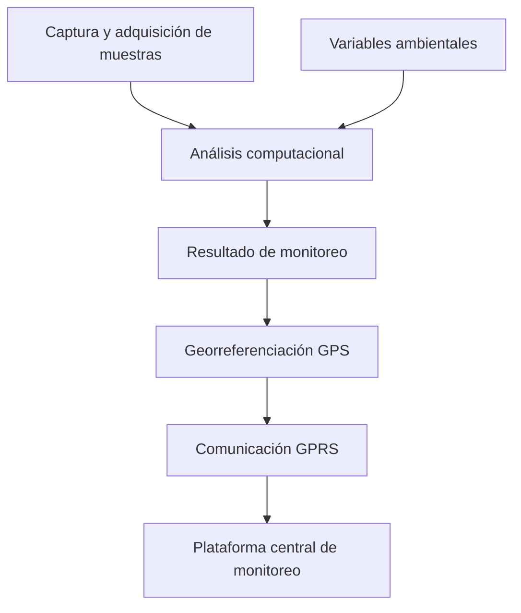

  

  
  
  
  

# Proyecto Marea Roja: sistema inteligente de monitoreo de floraciones algales nocivas

**Investigación, ingeniería de hardware y software, sistemas inteligentes y desarrollo de producto**

Mi participación en el **Proyecto Marea Roja** combinó ingeniería de hardware y software con liderazgo técnico. Trabajé en una solución orientada al análisis y seguimiento de **floraciones algales nocivas (FAN)**, integrando adquisición de información, procesamiento computacional y modelos probabilísticos.

El proyecto evolucionó desde un **prototipo mecatrónico de laboratorio** hacia un **dispositivo autónomo para embarcaciones menores**, con análisis a bordo y transmisión de información georreferenciada a una plataforma de monitoreo. El dispositivo fue construido físicamente, probado en campo y **comercializado a una empresa privada**.

> **Alcance de este repositorio:** caso de estudio profesional de alto nivel. Los algoritmos, diseños del laboratorio, planos mecánicos, circuitos, código y detalles internos del producto no se publican por restricciones de propiedad industrial.

## 🎯 El desafío

El estudio de floraciones algales potencialmente nocivas requiere observar variables ambientales y analizar muestras. El reto tecnológico fue integrar varias disciplinas en una solución capaz de apoyar la adquisición, análisis y comunicación de información desde laboratorio y, posteriormente, desde entornos de operación en campo.

## 🔬 Fase 1 · Prototipo de laboratorio

Participé en el desarrollo e integración de un sistema mecatrónico para el análisis de muestras, con elementos de:

- **Adquisición automatizada de imágenes** mediante un sistema de microscopía y posicionamiento.
- **Mecatrónica y electrónica**, con actuadores, motores y sensores para el movimiento y la captura.
- **Procesamiento de imágenes**, utilizado como parte del análisis de muestras.
- **Red bayesiana**, planteada como herramienta de inferencia a partir de variables ambientales y de calidad del agua.

Los entregables técnicos históricos describen estas líneas de trabajo, así como el diseño del software y la integración de módulos. La documentación interna permanece fuera del repositorio público.

## 🚤 Fase 2 · Dispositivo autónomo en campo

Posteriormente trabajé en la evolución del proyecto hacia un **dispositivo autónomo instalado en embarcaciones menores**. Esta segunda fase permitió:

1. Realizar adquisición y análisis de información desde el dispositivo.
2. Asociar los resultados con coordenadas obtenidas mediante **GPS**.
3. Transmitir datos georreferenciados mediante **GPRS**.
4. Recibirlos en una **plataforma central de monitoreo**.

La existencia, pruebas en campo y comercialización de esta segunda fase se describen aquí a partir de mi experiencia directa; los documentos técnicos aportados corresponden principalmente a la primera fase.

## 🧭 Visión funcional del sistema

*Diagrama conceptual para explicar la función general. No representa la arquitectura ni los algoritmos propietarios.*

## 👤 Mi responsabilidad

Me desempeñé como **Ingeniero de Hardware y Software y Líder Técnico**. Participé en el desarrollo de los componentes tecnológicos, su integración y la evolución del proyecto desde el sistema de laboratorio hacia el dispositivo de campo.

El proyecto también formó parte de mi trabajo de investigación durante los estudios de **Maestría en Mecatrónica**. Los derechos industriales impidieron publicar los algoritmos y diseños técnicos; esta referencia no implica que haya obtenido el grado académico.

## ✅ Resultado y aprendizaje empresarial

El dispositivo se **construyó, probó en campo y vendió como producto final** a una empresa privada. Más adelante dejó de utilizarse tras una evaluación del contexto económico: el costo de la prevención de FAN se consideró superior al de actuar ante estos eventos.

Esta experiencia me mostró una lección que sigo aplicando en proyectos tecnológicos: **desarrollar un producto funcional no garantiza su continuidad comercial**. La viabilidad depende también del costo de operación, del beneficio esperado y de las decisiones del cliente.

No publico cifras de precisión, ahorros, costos o alcance operativo porque no contamos con evidencia cuantitativa pública suficiente para sustentarlas.

## 🔐 Propiedad industrial y fuentes

Este repositorio **no contiene código fuente ni documentación técnica original**. Describe únicamente el objetivo general, las fases, mi participación y los resultados que puedo comunicar públicamente. El software, los diseños y los documentos técnicos originales conservan los derechos de sus titulares.

- [Contexto, atribuciones y límites de divulgación](docs/project-context.md)
- Referencia histórica: documentos del proyecto *«Prototipo innovador para el pronóstico de fitoplancton potencialmente nocivo basado en herramientas bayesianas y biomarcadores lipídicos»* (2011).

---

<strong>De la investigación al dispositivo autónomo, de las pruebas en campo a la evaluación de viabilidad comercial.</strong>

Proyecto documentado por <a href="https://github.com/isaiassolis">Isaías Solís</a>
