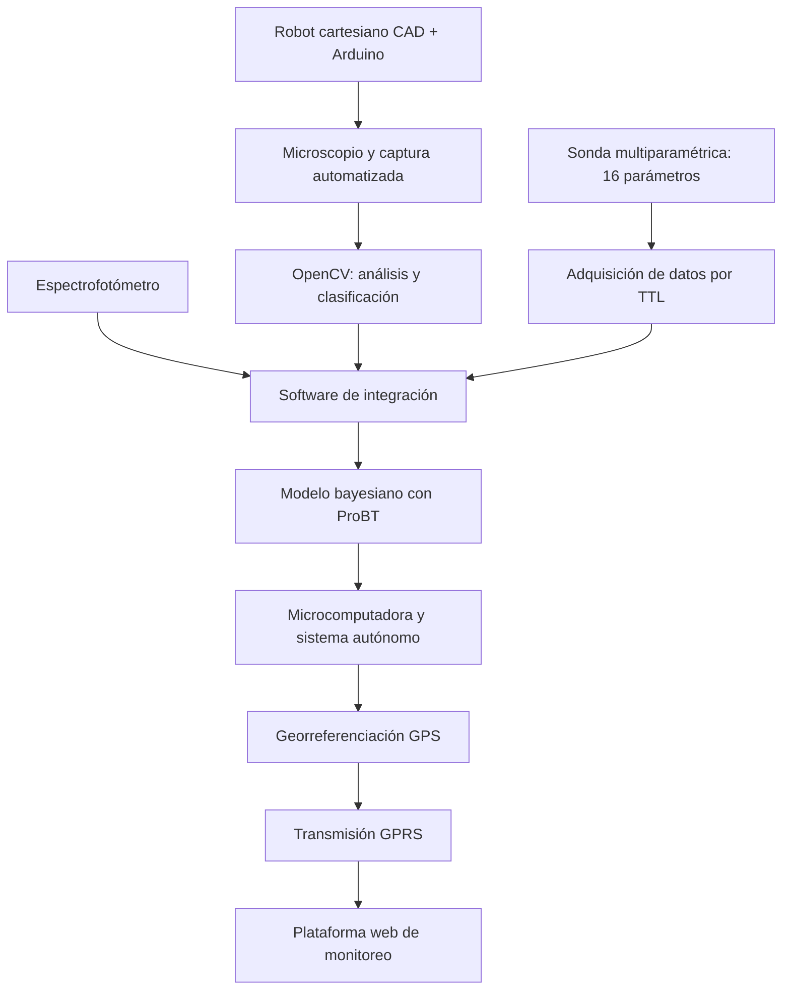

  

  
  
  
  

# Proyecto Marea Roja — Sistema inteligente de monitoreo de floraciones algales nocivas

**Ingeniería mecatrónica · Robótica cartesiana · Visión computacional · Redes bayesianas · Sistemas de monitoreo**

Participé como **ingeniero de hardware y software y líder técnico** en un proyecto de investigación y desarrollo para el monitoreo de **floraciones algales nocivas (FAN)**, conocidas como marea roja.

Mi trabajo abarcó desde el **diseño CAD de un robot cartesiano para microscopía automatizada** hasta la integración de instrumentación científica, clasificación de dinoflagelados mediante **OpenCV**, modelado de inferencia bayesiana y desarrollo de software para un sistema autónomo de adquisición y análisis de datos.

Durante **tres años de desarrollo**, evolucionamos de un prototipo de laboratorio a un dispositivo físico probado en campo y una plataforma web para consultar información georreferenciada. El equipo se comercializó a una empresa privada.

## El desafío

El análisis de posibles eventos de marea roja necesita combinar la observación de microorganismos con las condiciones físicas y químicas del agua. El reto era **automatizar la captura y el procesamiento de muestras, integrar instrumentos científicos y aprovechar los datos para apoyar el análisis de riesgos**.

Necesitábamos conectar en una misma solución **mecánica de precisión, electrónica, software, visión computacional, adquisición de datos y modelos probabilísticos**.

## Primer año — Robot cartesiano, instrumentación y modelo bayesiano

### Robótica y microscopía automatizada

Diseñé mediante **CAD** un pequeño **robot cartesiano**, basado en coordenadas euclidianas, para automatizar el movimiento durante la adquisición de imágenes con un microscopio.

Utilicé **Arduino** para controlar los movimientos y desarrollé la integración con el software de captura. Para el análisis de las imágenes trabajé con **OpenCV**, orientado a la **clasificación de dinoflagelados** presentes en las muestras.

### Integración de instrumentos científicos

Integré al sistema:

- Una **sonda multiparamétrica** que proporcionaba **16 parámetros de calidad del agua**, comunicada con el software mediante **TTL**.
- Un **espectrofotómetro**, conectado con el sistema de adquisición y análisis.
- Un **microscopio** con captura de imágenes y posicionamiento automatizado.

### Inteligencia artificial y análisis de datos

Diseñé el **modelo bayesiano** del proyecto, incluyendo la selección de variables relevantes y la preparación de información histórica.

Realicé actividades de **limpieza de datos históricos**, así como la integración de información obtenida durante el entrenamiento y trabajo de laboratorio en sitio.

Programé la **red bayesiana utilizando ProBT de ProBayes**, vinculándola con los datos utilizados para el análisis de las condiciones ambientales.

## Segundo año — Construcción del equipo y pruebas en campo

En la segunda etapa construimos e integramos el equipo físico, incorporando una **microcomputadora con el software automatizado**, junto con:

- El sistema de microscopía y captura.
- El robot cartesiano y su control electrónico.
- El espectrofotómetro.
- La sonda multiparamétrica.
- Los componentes de procesamiento, adquisición y análisis desarrollados durante la primera etapa.

Esta integración permitió trasladar el sistema de laboratorio a un **equipo autónomo**, con el que realizamos **pruebas en sitio**.

## Tercer año — Plataforma web, GPS y GPRS

En la tercera etapa desarrollamos una **plataforma web de monitoreo** para recibir y consultar la información del sistema.

Integramos **GPS para la georreferenciación** de las mediciones y **GPRS para su transmisión hacia tierra**, conectando el dispositivo con la plataforma de monitoreo.

Así extendimos el sistema desde la captura y análisis local de muestras hasta el **seguimiento remoto de información ambiental**.

## Arquitectura funcional

*Representación funcional de los componentes desarrollados a lo largo de las tres etapas.*

## Tecnologías y herramientas

| Área | Tecnologías y componentes |
| :--- | :--- |
| **Diseño mecatrónico** | CAD, robot cartesiano, coordenadas euclidianas |
| **Control de movimiento** | Arduino |
| **Programación** | C++, C# |
| **Visión computacional** | OpenCV, microscopía digital |
| **Instrumentación** | Sonda multiparamétrica de 16 parámetros, comunicación TTL, espectrofotómetro |
| **Inteligencia artificial** | Redes bayesianas, **ProBT (ProBayes)**, selección de variables y limpieza de datos |
| **Aplicación web** | ASP.NET |
| **Equipo de campo** | Microcomputadora y adquisición automatizada |
| **Telemetría** | GPS, GPRS |

## Mi participación

Asumí responsabilidades directas de **diseño, programación, integración e ingeniería**, además del liderazgo técnico del proyecto.

Entre mis contribuciones estuvieron el diseño CAD del robot cartesiano, la programación del movimiento automático con Arduino, la integración de OpenCV para la clasificación de dinoflagelados, la comunicación TTL de la sonda de calidad del agua, la integración del espectrofotómetro y el diseño e implementación de la red bayesiana con ProBT.

También participé en la construcción e integración del equipo autónomo, las pruebas en campo y el desarrollo posterior de la plataforma de monitoreo y su conectividad.

El proyecto estuvo relacionado con mis **estudios de Maestría en Ingeniería Mecatrónica**.

## Resultados y evolución comercial

El trabajo avanzó de un sistema de laboratorio a **un equipo físico integrado**, probado en sitio, con una plataforma de monitoreo remoto. El dispositivo se **comercializó a una empresa privada**.

Posteriormente, el cliente decidió suspender su utilización tras evaluar los costos de prevención frente a los costos de responder a eventos de floraciones algales en su contexto operativo.

Esta experiencia me permitió recorrer un ciclo amplio de desarrollo: **investigación, diseño mecánico, electrónica, programación, integración científica, pruebas de campo y comercialización**.

## Sobre el proyecto

La investigación original se desarrolló bajo el título **«Prototipo innovador para el pronóstico de fitoplancton potencialmente nocivo basado en herramientas bayesianas y biomarcadores lipídicos»**.

Este repositorio presenta mi participación profesional y la evolución del sistema. No distribuye código fuente, planos, circuitos ni materiales técnicos propietarios.

[Conocer más sobre las etapas y mi participación](docs/project-context.md).

---

<strong>Del diseño de un robot cartesiano al monitoreo ambiental automatizado y remoto.</strong>

<a href="https://github.com/isaiassolis">Volver a mi portafolio profesional</a>

