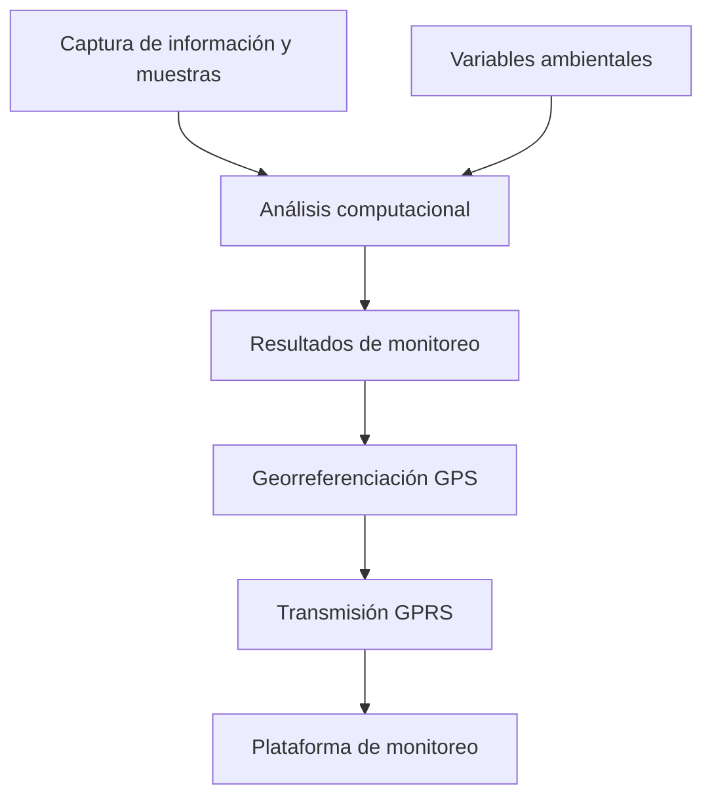

  

  
  
  
  

# Proyecto Marea Roja — Sistema inteligente de monitoreo ambiental

**Liderazgo técnico · Ingeniería de hardware y software · Investigación aplicada y desarrollo de producto**

Participé como **ingeniero de hardware y software y líder técnico** en el desarrollo de un sistema para el estudio y monitoreo de **floraciones algales nocivas (FAN)**, conocidas comúnmente como marea roja.

El proyecto comenzó con un **prototipo mecatrónico de laboratorio** que integraba adquisición de imágenes, procesamiento computacional y modelos de inferencia. Posteriormente evolucionó hacia un **dispositivo autónomo para embarcaciones menores**, capaz de procesar información y transmitir resultados georreferenciados.

El dispositivo fue **construido, probado en campo y comercializado a una empresa privada**. Esta experiencia conectó la investigación académica con la ingeniería de un producto físico.

## El desafío

El análisis de floraciones algales nocivas requiere estudiar muestras y variables ambientales, interpretar información y relacionar los resultados con el lugar donde se obtuvieron.

Nuestro reto fue integrar **mecatrónica, electrónica, software y análisis computacional** para facilitar la adquisición y el seguimiento de datos, primero en un entorno de laboratorio y después en condiciones de campo.

## De la investigación al dispositivo autónomo

### Primera etapa — Prototipo de laboratorio

Trabajamos en el desarrollo de un sistema mecatrónico orientado al análisis de muestras y a la adquisición automatizada de información.

Entre los componentes del trabajo se encontraban:

- **Microscopía y captura de imágenes:** adquisición de imágenes con mecanismos de posicionamiento.
- **Mecatrónica y electrónica:** integración de motores, actuadores y sensores para la operación del prototipo.
- **Procesamiento de imágenes:** herramientas computacionales para apoyar el análisis de muestras.
- **Modelado bayesiano:** estudio de variables ambientales y de calidad del agua mediante técnicas de inferencia.

Esta etapa formó parte de un proyecto multidisciplinario de investigación iniciado en **2011**.

### Segunda etapa — Monitoreo en campo

Posteriormente participamos en la evolución del sistema hacia un **dispositivo autónomo para embarcaciones menores**.

La solución integraba capacidades para:

1. Adquirir y analizar información desde el propio dispositivo.
2. Asociar los resultados con coordenadas mediante **GPS**.
3. Enviar información georreferenciada a través de **GPRS**.
4. Concentrar los datos recibidos en una **plataforma de monitoreo**.

El desarrollo culminó en un equipo físico que fue **probado en campo y vendido a una empresa privada**.

## Funcionamiento general

## Mi participación

Me desempeñé como **ingeniero de hardware y software y líder técnico**. Participé en el desarrollo, la integración tecnológica y la evolución del proyecto desde el prototipo de laboratorio hasta el dispositivo destinado a la operación en campo.

Este trabajo también estuvo vinculado con mis **estudios de Maestría en Ingeniería Mecatrónica**, donde participé en actividades de investigación relacionadas con el proyecto.

La experiencia reunió **desarrollo de sistemas embebidos, electrónica, mecatrónica, procesamiento de información, integración de comunicaciones y liderazgo técnico**.

## Resultados y experiencia de producto

El proyecto pasó por distintas etapas:

- **Investigación y prototipo de laboratorio**, con adquisición y procesamiento de información.
- **Desarrollo de un dispositivo autónomo**, preparado para su uso en embarcaciones menores.
- **Pruebas de campo** del equipo físico.
- **Comercialización del dispositivo** a una empresa privada.

Posteriormente, el cliente decidió dejar de utilizar la solución al evaluar la relación entre sus costos de prevención y los costos de responder a los eventos de floración algal.

Esta experiencia me permitió comprender una dimensión esencial del desarrollo tecnológico: **construir una solución funcional es solo una parte del reto; su continuidad también depende de las condiciones económicas y operativas del cliente**.

## Sobre el proyecto

El trabajo de investigación original se desarrolló bajo el título **«Prototipo innovador para el pronóstico de fitoplancton potencialmente nocivo basado en herramientas bayesianas y biomarcadores lipídicos»**.

Este repositorio presenta mi participación y la evolución tecnológica del proyecto. Los diseños industriales, algoritmos, código fuente y documentación técnica interna pertenecen a sus respectivos titulares.

[Conocer más sobre el desarrollo y mi participación](docs/project-context.md).

---

<strong>De la investigación en laboratorio a un dispositivo probado y comercializado.</strong>

<a href="https://github.com/isaiassolis">Volver a mi portafolio profesional</a>

